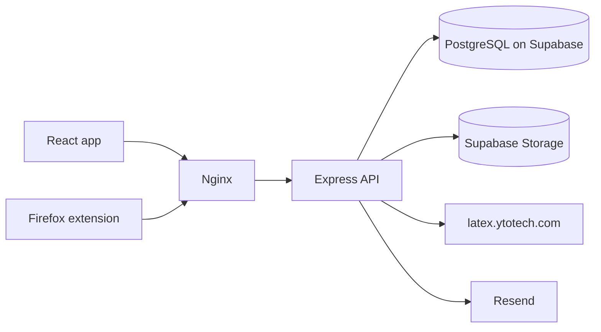

# ApplyThis

A full-stack job application tracker with a built-in LaTeX resume editor and a Firefox extension that saves job postings as you browse.

**[Live demo](https://hazmimosbah.com/applythis)**: click "Try it yourself!" on the login page (no signup needed)

## Features

- Track every application through a status pipeline, with status history
- Analytics dashboard: stats, status charts, recent jobs/resumes and weekly activity
- Drag-and-drop ordering and status filters, with a prompt for applications that have gone quiet
- LaTeX resume editor with autosave, formatting shortcuts and a live PDF preview
- Resume library with thumbnails, duplication and attaching a resume to each job
- Firefox extension that saves a job posting in one click
- Accounts with email verification, password change and reset, and account deletion
- One-click demo mode with temporary accounts

## Screenshots

**Application Pipeline Dashboard**
Stats, a status flow chart and weekly activity show where every application stands.

**Track Every Application**
Filter by status, reorder by dragging, and spot applications that have gone quiet.

**Built-in LaTeX Resume Editor**
Write LaTeX with autosave, then compile and preview the PDF side by side.

**Organized Resume Library**
Thumbnail cards for every resume, can click to open, duplicate, rename, reorder or delete.

**Save Jobs While Browsing**
The Firefox extension adds a posting to your tracker in one click.

## Tech stack

| Area | Technologies |
|---|---|
| Frontend | React, TypeScript, Vite, React Query, CodeMirror 6, Radix UI, pdf.js, Recharts |
| Backend | Node.js, Express, TypeScript, Prisma, JWT |
| Data | PostgreSQL (Supabase), Supabase Storage (S3-compatible) |
| Services | Resend (email), latex.ytotech.com (LaTeX compilation) |
| Infrastructure | AWS EC2, Nginx, GitHub Actions |
| Extension | Firefox WebExtension [manifest v3] |

## Architecture

Nginx serves the React app and proxies `/api` to Express. The API compiles LaTeX through a third-party service, so the browser never calls it directly.

## Decisions

- **Demo sandbox.** Each visitor gets a throwaway account with seeded data. Per-IP, per-user and global rate limits, caps on resume source code and the number of jobs/resumes to protect the server and the LaTeX service, and hourly job deletes of expired accounts and their stored files. Demo accounts are removed after 24 hours and no extension access.
- **Fractional ordering.** Dragging a job changes one database row, using a number between its new neighbours, instead of renumbering the whole list.
- **Caching.** React Query instead of plain useEffect + useState fetching. The Dashboard, Jobs and Resumes pages all load overlapping data, and with plain fetching every page visit meant a new request and a loading spinner. React Query keeps one shared cache, so revisiting a page is instant while it refreshes in the background, and changes like adding new job or deleting a resume mark the data as stale so the dashboard numbers stay correct. It also made it easy to prefetch the dashboard data during the demo login, so the first screen shares only one loading screen.
- **Session security.** JWT access and refresh tokens, single-use hashed password-reset tokens, and a passwordChangedAt check that makes every older refresh token invalid after a password change, so other sessions can’t renew themselves. Deleting accounts also removes the stored files.
- **LaTeX compile proxy.** The backend calls the compile service with a timeout and reduces its large log to a short error message   (if there's any). The editor has an error counter, when clicked it pop a list of errors. Successful compiles are stored as a PDF with generated thumbnail and both get stored. 
- **Autosave.** The editor saves after a pause in typing and shows whether the text is saved and whether the PDF is up to date.

 
 
 
 
developed without the use of child labor
